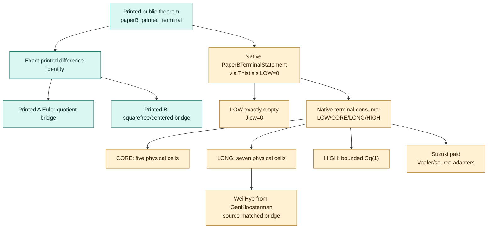
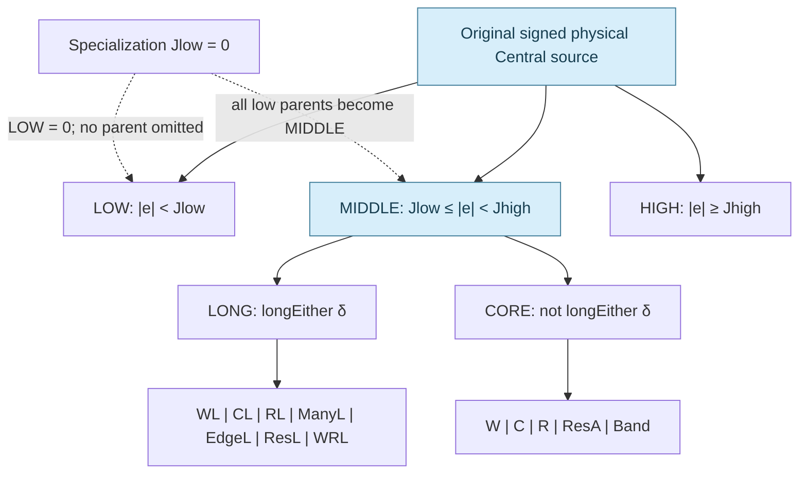
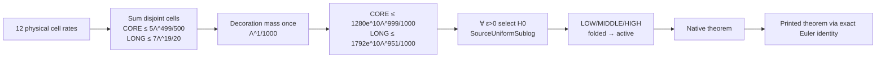

# Paper B · Proof graph and evidence legend

**R0003 source cut.** These graphs are intentionally *smaller* than the module import graph. They present logical architecture, not a claim to have machine-extracted every constant in the elaborated proof term. The machine-readable edges, with evidence classification, live in `04_PROOF_EDGE_COURT.csv` and `02_INTEGRATED_ATLAS_DATA.json`.

## Diagram A — Two branches at the final theorem

**Interpretation:** arrows are proof-source dependencies or transparent semantic condensations. The top printed theorem has two direct named mathematical inputs. The lower boxes compress intermediate Lean declarations and must not be mistaken for one-step `exact` calls. Use the typed edge CSV for that distinction.

## Diagram B — Physical source conservation

The exact three-sector source identity is `Merivelle.Central.regionSum_three_sectors` (`ThreeSectorConsumer.lean:84–92`). The exact complement identity is `Merivelle.Central.foldedMiddle_long_core` (`MiddleLongCoreConsumer.lean:19–26`). The five- and seven-cell identities are `QuillonCoreFinal.pair_decomp` and `QuillonLongFinal.long_pair_decomp`. Their precise masked definitions—not this graphic—are authoritative.

## Diagram C — How quantitative claims propagate

This records the **mathematical mechanism** of rate transport. It does not assert one direct Lean theorem-call edge between each adjacent graphic box. The exact nested epsilon allocation (including the folded-to-active error) is in the main exposition and Pass 5 ledger.

## Evidence legend

| Code | What the record supports | What it does not support |
|---|---|---|
| `direct` | Consumer's visible proof text names the supplier declaration | Full elaborated proof-term transitive closure |
| `via` | Named or mathematically explicit dependency through intervening declarations | That the boxes are adjacent in the kernel DAG |
| `method` | The cell lemma feeds a sector assembly, via named intermediate estimates and triangle bounds | That the sector directly invokes the final cell in one step |
| `source_inspected` | Exact cited archived bytes, their SHA-256, and statement/body location inspected | Fresh local Lean replay or an independent mathematical correctness verdict |
| `external novelty` **unresolved** | Classical names and current-file mechanism classification | Priority/originality relative to all earlier mathematics |

**Important scope:** the RC archive has 675 modules import-reachable from `PaperB.lean`, but this is an import-reachability fact. This atlas does not equate it to the final theorem's transitive proof-constant count. A future elaborator audit would require exact proof-expression extraction, not just source or import inspection.

## Reuse contracts

The unified JSON contains:

- `terminal_nodes`: 16 source-anchored declarations at the endgame.
- `proof_edges`: 26 typed edges, all distinguished by `direct`, `via`, or `method` standing.
- `cards`: 62 mathematical mechanisms (15 Euler/finite, 35 analytic engines, 12 physical cells).
- `cells`: twelve full six-step physical traces, exact masks, methods, rate ladders, limits and original-code excerpts.
- `power_graph`: Pass 5's separately typed 41-node/41-edge quantitative propagation graph.
- `equation_transitions`: 25 A/B/finite-dictionary steps.
- `parameters`: 21 symbol and quantifier records.
- `sources`: 70 distinct SHA-256-identified source files.

A reader may reuse those machine-readable objects to prepare mathematical expositions or independent source reviews. A citation to this atlas is not a substitute for citing the original file and declaration stored on that object.
