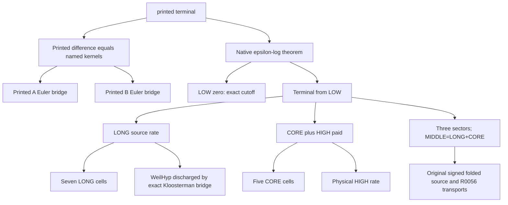

# Paper B Technique Atlas — Pass 1: Printed-Terminal Backward Trace

**Selvara / FACET · 23 October 2026 · Read-only source archaeology**

## Result

**PASS at source-bound top-level scope, not yet a certified transitive proof-constant audit.** The October 23 R0003 archive passes its supplied SHA-256 sidecar and ZIP integrity check. `SEAL/verify_snapshot.py` reports `SEAL_PASS 683 HASHED_FILES`. There are **676** `.lean` files, of which **675** are import-reachable from `PaperB.lean`; the one exception is `SEAL_CHECK/PrintedTerminalAxioms.lean`. This is an import count, not a count of theorems used by the final proof. The bundle's `SEAL/ENVIRONMENT.json` reports an isolated R0003 build and three standard axioms, but I did **not** independently rebuild this ZIP here.

The archive fixes the manuscript `MANUSCRIPT/paper_b_frozen.canonical.tex` separately from the Lean printed terminal. Its release metadata explicitly says **external referee approval and independent replay remain pending**.

## 1. Literal root: what is actually proved

`LEAN/Orienne/Publication/PaperBPrintedTerminalR0001.lean`, lines 8–31, declares:

`Orienne.Publication.paperB_printed_terminal`

For each positive squarefree `q` and each positive `ε`, there is a threshold `h0` depending on `q, ε`, such that **all** reduced compatible endpoint choices `a,b` and all eligible positive `h ≥ h0` satisfy

`|Merivelle.F01.printedA1Literal q a h - Elarienne.F01B.printedB1Literal q a b h| ≤ ε * log h`.

The theorem uses precisely two substantive named inputs in its visible source proof:

1. `Thistle.LOW.paperB_terminal_via_empty_low` for the same epsilon statement on the **named manuscript kernels**.
2. `Elarienne.F01B.printedA_sub_printedB_eq_manuscriptKernels` for an **exact equality** of the literal printed difference and named manuscript-kernel difference.

These are different mathematical achievements. The second is a source-fidelity bridge; it is not another analytic little-o proof. The first relies on the physical signed-source analytic campaign; it is not a derivation of the Euler products. This is the essential two-branch top-level architecture.

## 2. Printed-Euler branch: where the source fidelity is paid

`LEAN/Orienne/Publication/F01PrintedLiteralBridgeR0001.lean` (1,481 lines) independently defines the occupied residue set `H.image (fun x => x % p)`, an Euler local factor `(1 - occupied/p)/(1 - 1/p)^|H|`, and a restricted `∏'` over primes not dividing `q`. It does **not** merely rename `manuscriptA1Kernel` or `manuscriptB1Kernel` as printed quantities.

The final exact difference identity, `printedA_sub_printedB_eq_manuscriptKernels` (line ~1470), rewrites by separate A and B bridges:

- `Merivelle.F01.printedA1Literal_eq_manuscriptA1Kernel` (line ~613). A branch: occupied pair/triple counts; local factor identities; product convergence from eventual equality with an established baseline; positivity/nonzero factors; triple/pair Euler quotient; `printedA1Weighted` and exact admissible-index counting; arithmetic normalization.
- `Elarienne.F01B.printedB1Literal_eq_manuscriptB1Kernel` (line ~1444). B branch: one-anchor printed `S1` Euler products, high/low prime factorization, eta/divisor expansions and absolutely convergent swaps, exact centered finite-row comparison; reflection `y ↦ h-y`, coprimality and translated occupied residue classes.

**Pass II must check these equations mathematically term by term** against the frozen TeX. Pass I has identified the definitions and named theorems, but has not independently refereed every Euler identity or endpoint normalization.

## 3. Native asymptotic branch: the actual proof pattern

`LEAN/Orienne/CSC3/LowZeroTerminalR0001.lean`:

- `lowSector_zero_exact`: `lowSector (fun _ => 0) q a h = 0`, by unfolding the **physical** source cutoff `e.card < 0`.
- `lowSector_zero_sublog`: the identically zero sector has uniform epsilon-log rate.
- `zero_cutoff_order`: `0 ≤ orienneCentralHighCut h`.
- `paperB_terminal_via_empty_low`: invokes `Orienne.CSC3.paperB_terminal_of_native_low` at `Jlow = 0` and `δ = 1/4`.

The supplier `paperB_terminal_of_native_low`, in `Orienne/CSC3/PhysicalLongBridgeQ0001.lean`, adds native LONG. It passes to `paperB_terminal_of_native_low_long`, which combines HIGH and already-paid CORE.

The source-exact decomposition is **two successive partitions**:

1. `Merivelle.Central.regionSum_three_sectors` in `PaperB/Gate3/CentralTransfer/ThreeSectorConsumer.lean`: `full physical region = LOW + MIDDLE + HIGH`, using cardinality `[0,Jlow)`, `[Jlow,Jhigh)`, and `[Jhigh,∞)` with strict original source masks.
2. `Merivelle.Central.foldedMiddle_long_core` in `PaperB/Gate3/CentralTransfer/MiddleLongCoreConsumer.lean`: `MIDDLE = LONG + CORE` using `longEither δ` and its complement, under the **same signed folded source**.

Thus setting `Jlow=0` does not delete the former low-cardinality parent terms: they remain inside MIDDLE and are now paid by the cutoff-uniform CORE/LONG theorems. This is an **exact algebraic support redistribution**, not an estimate on a positive LOW band.

The native rate suppliers:

- `GoldC.QuillonCoreFinal.core_sublog` establishes the CORE source rate **for arbitrary `Jlow` and `Jhigh`**, `0 < δ < 1/3`. Per decoration, five physical cells give at most `5 (log h)^0.998`, then the decoration sum is absorbed into an eventual `ε log h` rate. Native equivalence is established by `Orienne.CSC3.core_source_native_sublog` using `signed_core_copy_eq_native` (`rfl`).
- `GoldC.QuillonLongFinal.long_sublog` establishes the LONG source rate **for arbitrary `Jlow` and `Jhigh`**, assuming `GoldC.QuillonLWeil.WeilHyp`. Seven physical cells give at most `7 (log h)^(19/20)` per decoration. `Orienne.CSC3.quillon_weilHyp` discharges the named hypothesis using `norm_quillon_K_weil`; native/copy equality is again proved by `rfl`, rather than asserted in prose.
- The HIGH rate appears in `Merivelle.Central.orienne_highSector_sublog`, consumed via `Orienne.CSC3.paperB_terminal_of_native_low_long` from `Orienne/Central/HighCardRateR0002.lean`.

`Orienne/CSC3/WeilQuillonBridgeR0002.lean` makes the Quillon complete sum equal (with **reversed coefficient order explicitly verified**) to `GenKloosterman.kSum`; it then imports the general Weil–Estermann norm bound including the divisor-count and `gcd` conductor. We must trace that provider into Carlitz/Stepanov/general-modulus arithmetic in Pass III, not simply label it “Weil.”

## 4. Smallest truthful source-dependent graph

This is a **human condensation of source-visible implications**, not a machine-extracted transitive proof-constant graph. Many intermediate source adapters and classical sublemmas are omitted deliberately, to be recovered in later passes.

## 5. What the static inventory does not prove

- `PaperB.lean` import reachability is not theorem usage. No numeric count of actual theorem constants should be asserted until a Lean proof-expression extraction completes.
- Source `rw`, `exact`, and copied `rfl` evidence identifies explicit dependencies, but `simp`, automation, typeclass inference, and hidden definition unfolding can consume additional constants.
- The R0003 seal reports compiler acceptance, but this pass did not execute an independent R0003 Lean replay. The pinned source on the authorized Mac matches at least the two top-level files and LOW source by SHA, and is a promising future elaborator-audit surface; that alone is not a seal replay.
- Independent source-fidelity refereeing and publication approval are distinct from existence of the printed-terminal declaration.

## 6. Next pass: CONTINUE, not pivot

I recommend **Pass II as planned**, with an initial F-01 Euler equation-chain court (printed `A1` to manuscript kernel, then printed `B1` to reflected pair), and only then a source-first mining of the M1/M2 dictionary and finite CRT/Boolean apparatus. Pass I confirms the source bridge is a mathematically substantial and separately analyzable branch; skipping it would make the atlas unreliable at the public theorem boundary.

Run the proof-constant extractor as a parallel validation exercise when a bounded Lean court is available. The dependency-derived counts should be marked pending until then. No additional user source is needed.
